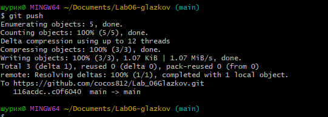
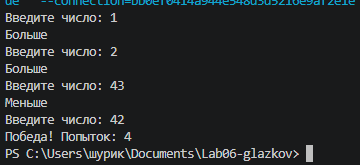

# Практическая работа №6
**ФИО: Глазков Александр**
**Группа: ИСП-242**
**Дата: 06.11.2026**

## Что изучено

- различные циклы
- вспомнили про break и continue из питона
- узнали про while и do while, их отличие заключается в том,что do while выполнит цикл хотя бы 1 раз не смотря на условия

